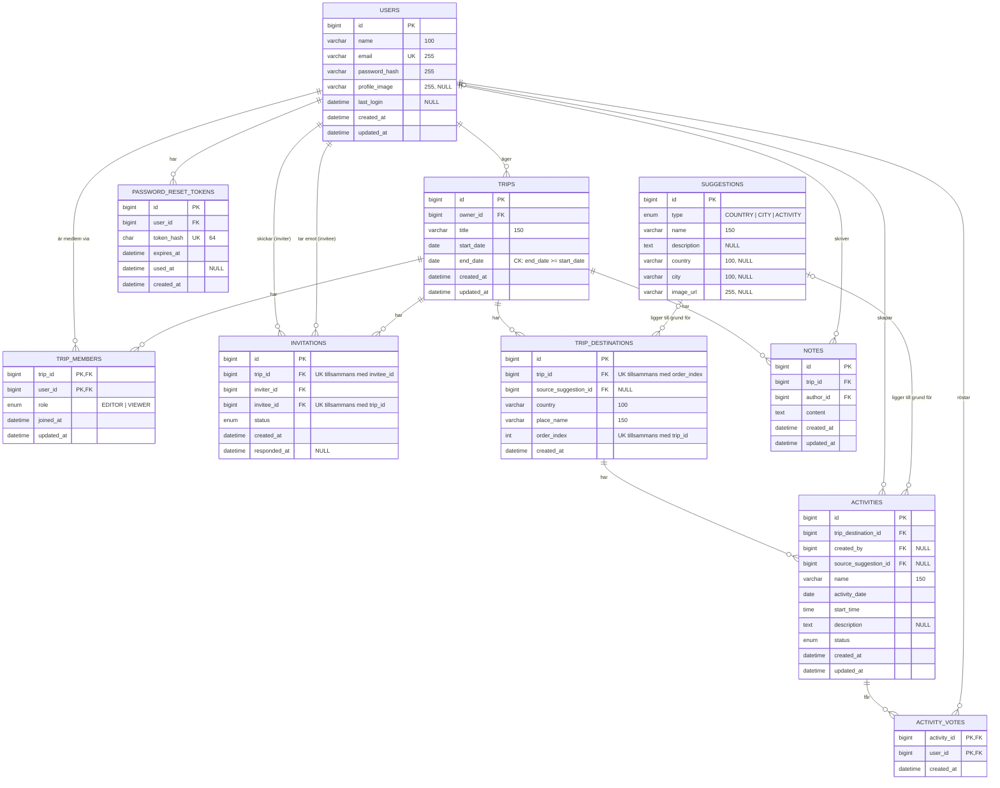

# Databasschema
 
Databas: MySQL. Schemat bygger på gruppens user stories och är normaliserat.
Alla primärnycklar är `BIGINT AUTO_INCREMENT` utom i kopplingstabellerna `trip_members` och `activity_votes`, som har sammansatta primärnycklar.
 
## Diagram
 

 
## Tabeller
 
| Tabell | Innehåll |
|---|---|
| `users` | Ett användarkonto med namn, unik e-postadress, hashat lösenord, valfri profilbild och senaste inloggning. |
| `trips` | En resa med titel och datumintervall. Varje resa har en ägare (`owner_id`). Ett villkor säkerställer att `end_date` inte ligger före `start_date`. |
| `trip_members` | Kopplingstabell mellan användare och resor (många till många). `role` anger om medlemmen är `EDITOR` eller `VIEWER`. Ägaren och accepterade inbjudna finns här. |
| `invitations` | En inbjudan från en användare (`inviter_id`) till en annan (`invitee_id`) att gå med i en resa. En användare kan bara bjudas in en gång per resa. När inbjudan har status ACCEPTED skapas en rad i `trip_members`. |
| `trip_destinations` | En destination (land och plats) i en resa. `order_index` bestämmer ordningen och är unik per resa. Kan valfritt komma från ett förslag. |
| `activities` | En aktivitet på en destination, med datum, starttid, beskrivning och status. Kan valfritt komma från ett förslag och har en skapare (`created_by`). |
| `activity_votes` | En användares röst på en aktivitet. Den sammansatta primärnyckeln (`activity_id` + `user_id`) ger en röst per användare och aktivitet. |
| `notes` | Anteckningar som hör till en resa, med författare och innehåll. |
| `password_reset_tokens` | Engångstoken för återställning av lösenord. Bara hashen sparas. Token har utgångstid och markeras som använd i `used_at`. |
| `suggestions` | Färdiga förslag på länder, städer och aktiviteter (`type`). Fristående tabell som destinationer och aktiviteter valfritt kan kopplas till. |
 
## Relationer
 
1. En användare kan skapa flera resor (`trips.owner_id`).
2. En resa kan ha flera destinationer, aktiviteter (via destinationerna) och anteckningar.
3. Flera användare kan delta i samma resa via `trip_members`.
4. En inbjuden blir medlem först när inbjudan accepteras.
5. Varje användare kan rösta en gång per aktivitet.
6. Kopplingen till `suggestions` är valfri (streckad linje i ERD:n) och kan vara NULL.
## Databasregler och antaganden
 
- **CASCADE:** Tas en resa bort raderas dess destinationer, medlemmar, inbjudningar, anteckningar och röster. Tas en användare bort raderas dennes `password_reset_tokens`.
- **SET NULL:** `activities.created_by` och båda `source_suggestion_id` sätts till NULL om raden de pekar på tas bort.
- **Backendregler:** Endast medlemmar i en resa får rösta. `activity_date` måste ligga inom resans datum. Detta kan inte uttryckas som kontrollvillkor i databasen och kontrolleras därför i backend.
- **Autentisering:** Auth antas vara stateless (JWT).
